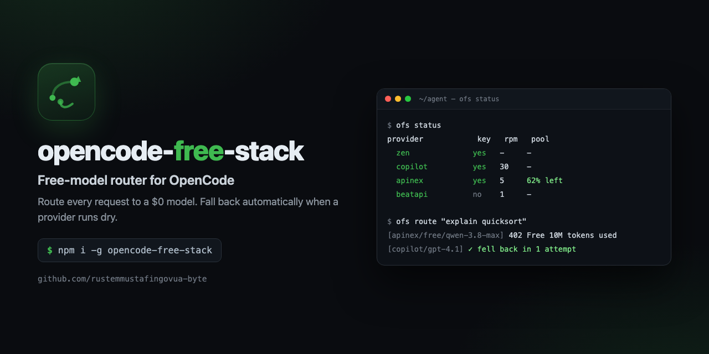
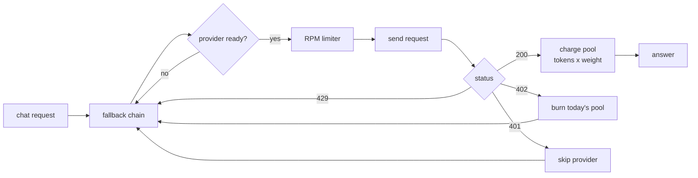

<div align="center">



# opencode-free-stack

**Free-model stack for [OpenCode](https://opencode.ai) — route every request to a model that costs $0, fall back automatically when a provider runs dry, and keep an eye on your daily quotas.**

[](https://github.com/rustemmustafingovua-byte/opencode-free-stack/actions/workflows/ci.yml)
[](https://www.npmjs.com/package/opencode-free-stack)
[](./LICENSE)
[](https://nodejs.org)
[](https://base.org)
[](https://rustemmustafingovua-byte.github.io/opencode-free-stack/)

[**Docs**](https://rustemmustafingovua-byte.github.io/opencode-free-stack/) · [Strategy](STRATEGY.md) · [Launch kit](LAUNCH.md) · [Issues](https://github.com/rustemmustafingovua-byte/opencode-free-stack/issues) · [Discussions](https://github.com/rustemmustafingovua-byte/opencode-free-stack/discussions)

</div>

---

## The problem

Free AI tiers look generous until you actually use them. Every failure is one of three limit systems:

| Limit | What it looks like | Which providers do it |
|---|---|---|
| **RPM** | `429 Rate limit exceeded` | all of them |
| **Daily token pool** | `402 Free 10M tokens used` | APInex (10M/day) |
| **Model weight** | the pool drains 2–4× faster than the token count suggests | APInex (`weight` 1–4) |
| **Plan gate** | `only available with a subscription` | APInex (Claude, Kimi, GLM Pro) |

An agent that picks one model and dies on a `402` is the most common way a "free AI" setup fails in production. This package removes that failure mode: it **knows every limit** and **moves the request to the next free model in the same turn**.

## Install

```bash
npm install -g opencode-free-stack
```

```bash
export OPENCODE_API_KEY=...   # OpenCode Zen
export GITHUB_TOKEN=...        # GitHub Copilot
export BEATAPI_API_KEY=...     # BeatAPI
export APINEX_API_KEY=...      # APInex
```

## Quickstart

```bash
ofs models            # every known free model, grouped by provider
ofs status            # which providers are configured, how much quota is left
ofs chain             # the exact fallback order that would be used
ofs route "explain quicksort"   # send one prompt through the chain
```

```js
import { routerFromEnv } from "opencode-free-stack"

const router = routerFromEnv()
const res = await router.chat([{ role: "user", content: "hi" }])

if (res.ok) {
  console.log(res.provider, res.model, res.content)
} else {
  console.error(res.attempts)   // why every provider refused
}
```

## How it works



1. **Build a chain** — the preferred model of each provider first, then its other free models.
2. **Wait out the RPM limit** — sliding window, no busy-wait spin.
3. **Send, and classify the failure** — `rate_limit`, `quota_exhausted`, `auth`, `upstream`.
4. **Charge the daily pool** with `tokens × weight`, so the router knows when a provider is done for the day.

## What is actually free

| Provider | Free models | The catch |
|---|---|---|
| **OpenCode Zen** | 10 | served only from inside OpenCode |
| **GitHub Copilot** | 5 | ~50 premium requests/month; Claude is blocked on the free SKU |
| **BeatAPI** | 5 | 1 request/min until you top up, 10/min after |
| **APInex** | 9 | 10M tokens/day, spent as `tokens × weight` (2–4×) |
| **Venice AI** | paid | Claude from $0.10/1M via x402 USDC — see [agent-x402](https://github.com/rustemmustafingovua-byte/agent-x402) |

The registry refreshes itself every 6 hours (`npm run sync-models`), because free tiers change without notice.

## Use it inside OpenCode

```jsonc
// opencode.json — copy from examples/opencode.json
{
  "provider": {
    "apinex": {
      "npm": "@ai-sdk/openai-compatible",
      "options": { "baseURL": "https://api.apinex.bond/v1", "apiKey": "{env:APINEX_API_KEY}" },
      "whitelist": ["free/qwen-3.8-max", "free/deepseek-v4-flash-0731"]
    }
  }
}
```

## The plugin: fallback inside a live session

The library and CLI are for your own code. The **plugin** is for OpenCode
itself: it watches for `session.error`, recognises a free-tier failure
(`402` pool exhausted, `429` rate limit) and continues the same turn with the
next free model — no manual model switch, no lost work.

```jsonc
// opencode.json
{
  "plugin": ["opencode-free-stack/plugin"]
}
```

```
[opencode-free-stack] apinex/free/qwen-3.8-max → copilot/gpt-4.1 (daily pool exhausted)
```

## Roadmap

- [x] provider registry with limits, weights and preferred models
- [x] RPM limiter and daily pool accounting
- [x] fallback router with error classification
- [x] CLI (`ofs`), tests, CI, npm publishing
- [x] hourly model-registry refresh
- [x] OpenCode plugin that continues a turn on the next free model
- [ ] hosted registry API with an x402 price
- [ ] policy file to pin which providers may be used at all

## Part of a portfolio

Thirteen MIT tools, one theme: making agent setups work, cheap and safe.

| Project | What it does |
|---|---|
| [`opencode-free-stack`](https://github.com/rustemmustafingovua-byte/opencode-free-stack) | route to free models, fall back automatically |
| [`free-web-mcp`](https://github.com/rustemmustafingovua-byte/free-web-mcp) | web search and page reading for agents, zero credits |
| [`agent-x402`](https://github.com/rustemmustafingovua-byte/agent-x402) | pay per API call in USDC with a spend policy |
| [`mcp-doctor`](https://github.com/rustemmustafingovua-byte/mcp-doctor) | check that MCP servers work, and say why they do not |
| [`mcp-proxy`](https://github.com/rustemmustafingovua-byte/mcp-proxy) | one endpoint, many MCP servers, with keys and limits |
| [`tool-schema-lint`](https://github.com/rustemmustafingovua-byte/tool-schema-lint) | lint MCP tool schemas before agents misuse them |
| [`prompt-budget`](https://github.com/rustemmustafingovua-byte/prompt-budget) | what does your system prompt cost per request? |
| [`agent-cost-guard`](https://github.com/rustemmustafingovua-byte/agent-cost-guard) | a budget in front of any OpenAI-compatible endpoint |
| [`opencode-doctor`](https://github.com/rustemmustafingovua-byte/opencode-doctor) | audit an OpenCode install in one command |
| [`free-tier-tracker`](https://github.com/rustemmustafingovua-byte/free-tier-tracker) | know your free quota before it runs out |
| [`x402-priceboard`](https://github.com/rustemmustafingovua-byte/x402-priceboard) | the price list of x402 endpoints, without paying |
| [`prompt-injection-guard`](https://github.com/rustemmustafingovua-byte/prompt-injection-guard) | find instructions hidden in files the agent reads itself |
| [`readme-doctor`](https://github.com/rustemmustafingovua-byte/readme-doctor) | why nobody uses your repository — checked in one command |

## Donate

MIT and free forever. If it saved you money, send USDC on **Base**:

```
0x8aC6a229f254980CCd3Dd35CF5E1B7c08880B40E
```

## Bounties

Issues labelled `💰 Reward` can be funded by anyone with `/reward <amount>` (Opire) or via [Algora](https://algora.io). The reward goes to whoever's PR gets merged — never to the repo owner. That is the point: it buys contributors, reviews and stars.

## Contributing

```bash
git clone https://github.com/rustemmustafingovua-byte/opencode-free-stack
npm install && npm test
```

Adding a provider is one entry in [`src/providers.js`](src/providers.js) — no other file changes. See [CONTRIBUTING.md](CONTRIBUTING.md) and [SECURITY.md](SECURITY.md).

## License

MIT © rustemmustafingovua-byte
